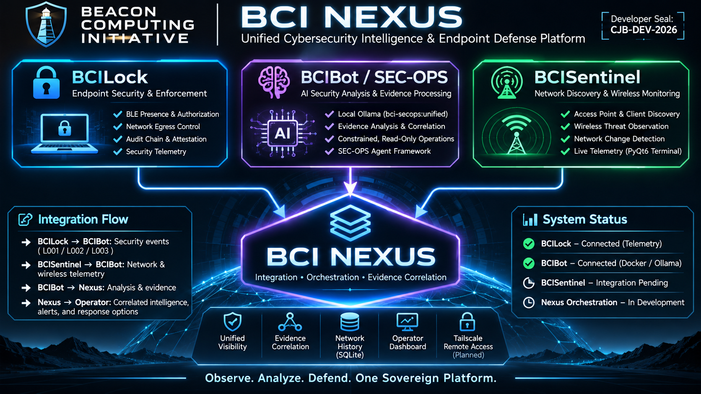
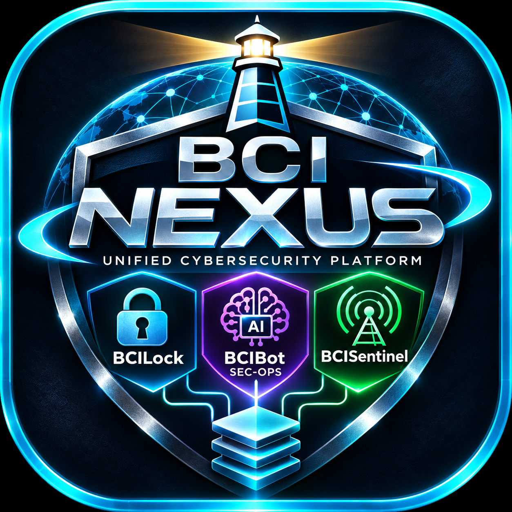

# BEACON COMPUTING INITIATIVE
**Developer Seal:** CJB-DEV-2026

# BCI NEXUS
### Unified Cybersecurity Intelligence & Endpoint Defense Platform

**Observe. Analyze. Defend. One Sovereign Platform.**

BCI Nexus is the integration and orchestration platform
connecting three independent Beacon Computing Initiative systems:

- **BCILock:** Endpoint authentication and network egress enforcement.
- **BCIBot / SEC-OPS:** Local AI security analysis and evidence processing.
- **BCISentinel:** Network discovery, wireless monitoring, and telemetry.

## Architecture

BCISentinel → BCIBot → Evidence Analysis

BCILock → Read-only Telemetry → BCIBot

BCI Nexus coordinates the components without transferring
authentication or firewall authority to the language model.

## Integration Status

The platform is built around three separate projects. A verified BCILock-to-BCIBot read-only telemetry path and a Docker-hosted Ollama gateway exist on the developer workstation. The full BCISentinel-to-Nexus connection, evidence-gating upgrade, and operator dashboard are still pending.

| Project | Integrated responsibility | Current state |
|---|---|---|
| [BCILock](https://github.com/BeaconComputingInitiative/BCILock) | Endpoint authentication, egress observation and audit evidence | Read-only telemetry bridge tested locally |
| BCIBot / BCI SEC-OPS | Constrained read-only agent, unified local Ollama inference, evidence analysis | Shared agent routed to Docker port 11435; full grounding test pending |
| [BCISentinel](https://github.com/BeaconComputingInitiative/BCISentinel-) | Wireless observation, network indicators and PyQt6 Terminal Stream | Independent project; Nexus integration pending |
| BCI Nexus | Read-only CLI, agent action registry, evidence adapters and integration contracts | First-party development foundation published; end-to-end acceptance pending |

**Detailed [integration breakdown, trust boundaries and verification matrix](docs/INTEGRATIONS.md).**

## Executable integration foundation (v0.3.0)

Nexus provides a nonprivileged, read-only CLI for BCILock telemetry, Docker Ollama model health, Sentinel snapshot inspection, and a local IP/AP-change journal. The shared BCI SEC-OPS/BCILock integration remains independently installed. No firewall or BLE authentication authority is transferred to Nexus.

~~~sh
cd "$HOME/BCI/BCI-Nexus"
git pull --ff-only origin main
sha256sum -c SHA256SUMS
python3 -m unittest discover -s tests -v
bash scripts/install-user.sh
bci-nexus doctor
bci-nexus status
bci-nexus terminal
bci-nexus observe
~~~

The optional command bci-nexus ask-lock submits fresh BCILock evidence for advisory model analysis; its evidence-ID gate is structural only, not semantic verification. No automatic host scans, system services, Sentinel GUI modifications, or remote desktop configuration are included.

See [Runbook](docs/RUNBOOK.md) and [Security](SECURITY.md).

## BCIBot as the Nexus foundation (v0.3.0)

BCIBot / SEC-OPS is a **first-party component of Nexus** rather than a separate upstream repository. Its [constrained agent](nexus/agent.py), [action security tests](tests/test_agent.py), and [development foundation](docs/BCIBOT_FOUNDATION.md) are maintained here. BCILock and BCISentinel retain separate repositories.

    bci-nexus actions
    bci-nexus action host.summary
    bci-nexus agent-ask --inspect host.summary --inspect ollama.health "Review local host observations"

The model cannot select tools or execute privileged operations. This agent is a read-only foundation; full evidence validation, sanctioned scanning, and Sentinel GUI integration are still pending.
## Development Status

Integration in progress.

The containerized unified Ollama model and SEC-OPS gateway
have passed initial local connectivity and inference tests.

Evidence-gate validation, Sentinel integration, SQLite network
inventory, and Tailscale remote access remain development milestones.

## Security Principles

1. Observe accurately.
2. Preserve faithfully.
3. Analyze transparently.
4. Communicate securely.
5. Act deliberately.

## Integrity

Release artifacts and configuration files will be accompanied
by SHA-256 verification manifests.

## BCI Nexus Artwork

Artwork reflects the platform vision, not a claim that pending integrations are deployed.

## Unified operator window (v0.4 foundation)

The native PyQt6 Nexus GUI extends the existing Sentinel QMainWindow in place: no second GUI and no Docker display forwarding. It adds Nexus overview, BCIBot Docker agent and operator-approved container shell, read-only BCILock evidence and training artifact inventory. The Docker agent service is separately provisioned; a missing agent is shown as offline, not silently replaced by host execution. Training inventory is read-only and never promotes models automatically.

See [Unified GUI deployment](docs/UNIFIED_GUI.md). Launch after updating Sentinel with: `bash scripts/nexus-gui`.

## BCIBot agent transport correction (v0.4.1)

The native GUI accesses the Docker agent through a private, authenticated Unix socket in the persistent agent workspace. This avoids unreliable TCP port publishing from a Docker `--internal` bridge while retaining container shell access. Inference remains at `127.0.0.1:11435` and BCILock remains native. See [Docker agent runbook](docs/DOCKER_AGENT.md).

## BCIBot Swarm v0.5.0

Nexus chat now coordinates bounded operator-governed roles: coordinator, observed host tools, dual role-based Ollama analysis, verifier and SHA-256 auditor. Native SSID survey and local-only Nmap host discovery require explicit authorization. See docs/SWARM.md.

## BCIBot prompt input refresh (v0.5.2)

After an accepted chat/swarm job is dispatched, the PyQt prompt editor clears and regains keyboard focus. Its submitted text remains in the conversation history. If planning fails or the operator declines a host observation, the prompt field is not cleared.

## Sentinel consolidated export and auto-refresh (v0.5.3)

Unified Sentinel tabs 4–8 (Wireless Indicators, DNS Observation, Edge Flow,
Raw Prometheus Metrics and Terminal Stream) are removed from the visible tab
bar but kept alive as auto-updating data views. A single Export menu in the
upper-right of the tab bar writes any of those five datasets, or all five,
to UTF-8 JSON with a developer-sealed SHA-256 sidecar. Sentinel's existing
1.5-second snapshot/Prometheus polling continues in the background even
when the tab pages are hidden. An auto-sync status indicator shows data
availability and the most recent saved-state timestamp. Exported data is
point-in-time and may be stale when the API is offline.
